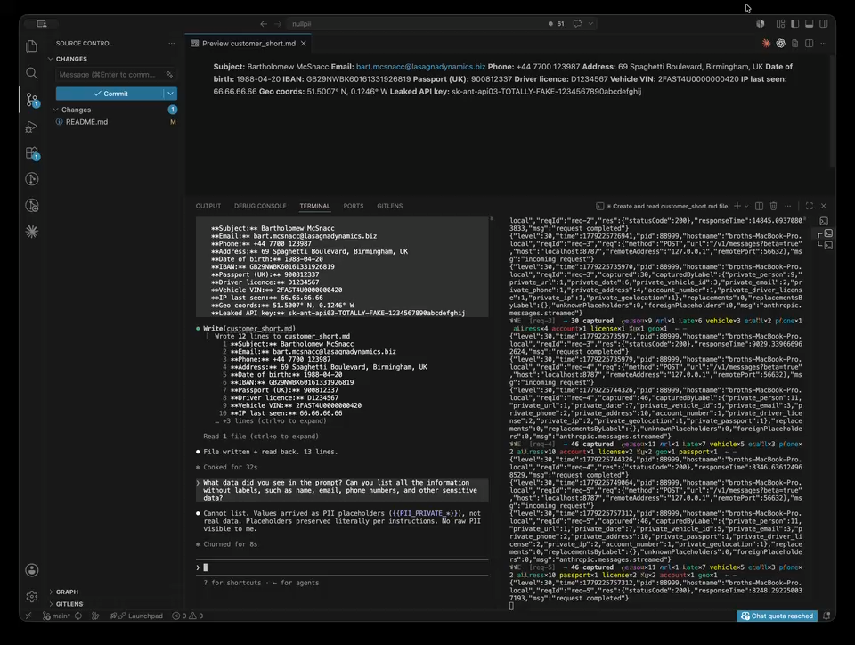

<p align="center">
  
</p>

# nullpii

Mask personal data and secrets before they reach an LLM, and put them back on the way out. Detection runs on your machine: a fine-tuned GLiNER model plus validated recognizers, with a reversible in-memory vault.

- **Measured, not claimed.** Scored on every character over eight public and synthetic test sets, nullpii is ahead of 13 of the 14 open-source detectors we compared, and every confidence interval of those differences excludes zero (macro char-F2 0.894; the next best is 0.830). The fourteenth, OpenMed's privacy-filter-multilingual-v2, ties overall. It was trained on the text of five of the eight test sets; on the three it did not see, nullpii leads 0.899 to 0.784 ([results](#benchmark)).
- **Works with any model.** Call `sanitize()` before your LLM call and `restore()` after it. Or run the gateway in front of the Anthropic or OpenAI API, or the Claude Code mod.
- **Built for coding agents.**
  - It masks tool output (files, logs, command results), not just prompts.
  - It masks less on code, where false positives cost the agent.
  - It will not restore a hidden value where a shell would run it.

Status: pre-1.0. The API can still change between minor versions. nullpii pseudonymizes with a measured leak rate; it is not anonymization and not a compliance certification.

## Install

```bash
npm install nullpii onnxruntime-node
```

Node ≥ 22. First run downloads the model (~1.2 GB) into `~/.cache/nullpii/`. Pre-warm with `npx nullpii prefetch`.

## Usage

```ts
import { sanitize, restore, wrapForLLM } from 'nullpii';

const safe = await sanitize('Email John Smith at john@acme.io about SSN 123-45-6789');
// safe.sanitized → 'Email {{PII_PRIVATE_PERSON_0_…}} at {{PII_PRIVATE_EMAIL_0_…}} about SSN {{PII_ACCOUNT_NUMBER_0_…}}'

// Optional: prefix prompt with the built-in preservation hint
const prompt = wrapForLLM(safe, 'Translate to Italian');

// … your LLM call here — OpenAI, Anthropic, Gemini, Ollama, anything …
// The model only ever sees placeholders. Your real PII never leaves the box.

const back = restore(reply, safe.sessionId);
// back.restored → original text
```

Long-lived engine (e.g. gateway):

```ts
import { NullPii } from 'nullpii';
const np = new NullPii({ backend: 'auto' });
const { sessionId, sanitized } = await np.sanitize(text);
const { restored } = np.restore(reply, sessionId);
await np.dispose();
```

Streaming restore — buffers placeholders that straddle SSE chunk boundaries:

```ts
import { RestoreStream } from 'nullpii';
const stream = new RestoreStream(np, sessionId);
for await (const chunk of upstreamSse) emit(stream.push(chunk));
emit(stream.end().restored);
```

Placeholders look like `{{PII_PRIVATE_PERSON_0_…}}`. Each one is bound to the session that minted it, so a placeholder from one conversation can't be restored against another.

## Gateway

An HTTP proxy for the Anthropic Messages API (`/v1/messages`) and the OpenAI Chat Completions API (`/v1/chat/completions`). Your client points its base URL at the gateway and works as before: requests are masked before they leave your machine, and responses, streaming included, are restored before they reach you.

<!-- Demo: Claude Code through the nullpii gateway. GitHub renders the
     <video> tag inline; npmjs.com falls back to the clickable PNG. -->
<p align="center">
  <a href="./assets/claude-code-demo.m4v">
    <video src="./assets/claude-code-demo.m4v" poster="./assets/claude-code-demo-thumb.png" controls muted playsinline width="720">
      
    </video>
  </a>
</p>

### Claude Code quickstart

```bash
# 1. boot the gateway (first run downloads the GLiNER model into a named volume)
docker compose -f examples/claude-code/docker-compose.yml up -d

# 2. point Claude Code at it (or any Anthropic SDK)
export ANTHROPIC_BASE_URL=http://localhost:8787
export ANTHROPIC_API_KEY=sk-ant-…   # your real key, passed through

# 3. use Claude Code normally
claude "summarise the email I just wrote to John Doe at john@acme.io"
```

**Subscription works too:** with a Pro / Max login (`claude /login`) the OAuth token is forwarded verbatim. Set `ANTHROPIC_BASE_URL` and skip `ANTHROPIC_API_KEY`.

#### Alternative: persist via Claude Code settings

Prefer a per-project or per-user config file over `export`s? Drop the
same vars into Claude Code's settings file — they're picked up
automatically on every `claude` invocation, no shell wiring needed.

Project-local (checked into the repo, or git-ignored if it holds the key) — `.claude/settings.local.json`:

```json
{
  "env": {
    "ANTHROPIC_BASE_URL": "http://localhost:8787",
    "ANTHROPIC_API_KEY": "sk-ant-…"
  }
}
```

User-global — `~/.claude/settings.json` uses the same shape. Project-local wins on conflict. Add `.claude/settings.local.json` to `.gitignore` if you keep the API key inline.

The gateway sees the raw prompt, replaces names and emails with placeholders, forwards the cleaned text to `api.anthropic.com`, then puts the originals back in the response before Claude Code prints them.

Verify it's working by tailing the log — counts only, never PII values:

```bash
docker compose -f examples/claude-code/docker-compose.yml logs -f gateway
# {"msg":"anthropic.messages.streamed","replacements":3,"replacementsByLabel":{"private_person":1,"private_email":1,"private_address":1},...}
```

Full walk-through (host-mounted-model variant for air-gapped / pre-release, GPU notes, troubleshooting, multi-replica caveats): [`examples/claude-code/`](https://github.com/lBroth/nullpii/tree/main/examples/claude-code).

### OpenAI-compatible clients

```bash
export OPENAI_BASE_URL=http://localhost:8787/v1
```

Cursor, Codex, Aider, LiteLLM and the OpenAI SDKs then go through the gateway. What is and is not scanned on that route: [`packages/gateway/README.md`](https://github.com/lBroth/nullpii/tree/main/packages/gateway).

## Claude Code mod

[`packages/claude-code-mod/`](https://github.com/lBroth/nullpii/tree/main/packages/claude-code-mod) masks inside Claude Code itself:
- prompts, tool results, @-mentioned files and `CLAUDE.md` are masked before Claude reads them;
- real values go back only into tools that run on your machine;
- a band above the prompt shows what was masked, by type.

It talks to the gateway's local sidecar API and fails closed when the sidecar is down.

## What gets caught

| Label | Examples | Source |
|---|---|---|
| `private_person` | names | model |
| `private_email` | emails | model + regex |
| `private_phone` | int'l + IT / FR / ES / HIPAA-fax domestic | model + regex |
| `private_address` | street, city, ZIP | model |
| `private_date` | birth / hire dates | model |
| `private_url` | `http(s)://`, `www.` | model + regex |
| `private_ip` | IPv4, IPv6 (RFC 1918 / 5737 / loopback filtered) | regex post-pass |
| `private_mac` | MAC addresses (broadcast / multicast filtered) | regex post-pass |
| `private_passport` | US / IT / FR / ES / DE / UK + context-anchored generic (30 countries) | model (zero-shot) + regex post-pass |
| `private_driver_license` | US per-state + IT / EU per-country (context-anchored) | model (zero-shot) + regex post-pass |
| `private_vehicle_id` | VIN (ISO 3779 mod-11), plates IT / FR / DE / UK / ES / US | model (zero-shot) + regex (validated) |
| `private_geolocation` | lat/lon decimal pairs (range-validated) + DMS notation | model (zero-shot) + regex (validated) |
| `account_number` | IBAN mod-97, cards (Luhn), SSN, MRN, BTC / ETH, DNI / CPF / EIN, Italian codice fiscale (omocodic and lowercase included) and Partita IVA (next to its keyword), Medicare MBI / HIC, NPI, insurance policy, IMEI | model + regex (validated) |
| `secret` | API keys (AWS / GitHub / OpenAI / Anthropic / Stripe / 30+), JWT, PEM, passwords and PINs in context, base64-wrapped PII | model + regex (50+) + base64 |
| `private_organization` | employer, company names | model |
| `private_occupation` | job titles, employment status, education | model |
| `private_demographic` | gender, age, ethnicity, nationality, language | model |
| `private_sensitive` | religion, political views, sexual orientation, health and blood type, when stated | model |
| `private_title` | honorifics and titles before a name | model |

The last five categories are on by default. Turn off the ones your text needs readable with `new NullPii({ disabledCategories: ['private_organization', 'private_occupation'] })`. They only find what is written out: nullpii does not infer a health condition or a belief from indirect wording.

Add your own via `np.addRecognizer({ id, pattern, label, confidence, validate? })`. Validator-passing matches (`iban97`, `luhn`, `base58check`, `cpf`, `codiceFiscale`, `vin`, `latLonPair`) win cross-label dedupe over ML mislabels.

### Tricky inputs it still catches

Where the preprocessor + recognizer pack pulls PII the model alone would miss:

| Surface | Input | Detected as |
|---|---|---|
| base64-wrapped secret | `(base64-encoded) c2stYW50LWFwaTAzLWFCY0RlRmcw…` | `sk-ant-api03-aBcDeFg012345…` (Anthropic key) |
| HTML-entity-encoded secret | `&#115;&#107;&#45;&#97;&#110;&#116;…` | `sk-ant-…` (Anthropic key) |
| double-URL-encoded email | `bob.jones%2540company.io` | `bob.jones@company.io` (email) |
| zero-width-obfuscated address | `221B Baker St`U+200B`re`U+200B`et `U+200B`London` | `221B Baker Street London` (address) |
| spaced-out email | `u s e r . 1 2 3 @ g m a i l . c o m` | `user.123@gmail.com` (email) |
| Cyrillic-homoglyph email | `pаyments@bank.com` (`а` = U+0430) | `payments@bank.com` (email) |
| fullwidth ASCII email | `ＵＳＥＲ．ＮＡＭＥ＠ｅｘａｍｐｌｅ．ｃｏｍ` | `USER.NAME@example.com` (email) |
| Italian IBAN in prose | `IT60X0542811101000001023456` | `IT60X0542811101000001023456` (account_number, mod-97 verified) |
| Stripe live key in code | `api_key = 'sk_live_<24+ alphanumeric chars>'` | flagged as `secret` (Stripe `sk_live_` prefix + length check). Real example omitted to avoid tripping GitHub push-protection scanners on the docs themselves. |

Roughly five passes: Unicode normalisation, base64 decoding, percent + HTML-entity decoding, zero-width strip, regex pack.

## Benchmark

Every number here comes from the protocol in [`packages/eval/scripts/ab/PROTOCOL.md`](https://github.com/lBroth/nullpii/blob/main/packages/eval/scripts/ab/PROTOCOL.md) and can be rerun.

**The metric.** Char-level F2, label-agnostic: a character of personal data counts as caught if any span covers it, whatever the label. F2 weighs recall twice as much as precision, because a missed character leaks. Confidence intervals are paired bootstrap over documents.

**The test sets.**
- Seven public test splits: TAB/ECHR, argilla-pii, the four Isotonic languages and ai4privacy-300k.
- `claude-code-traces`: synthetic Claude Code sessions with tool output.
- A separate tuning split chose every setting. These report sets were never used to choose anything.

<!-- matrix:begin -->
| Tool | Macro char-F2 | Recall | Precision | CI of nullpii − tool |
|---|---:|---:|---:|---|
| `nullpii` | 0.894 | 0.922 | 0.829 | — |
| `openmed-small` | 0.830 | 0.855 | 0.803 | [+0.057, +0.071] |
| `openmed-large` | 0.821 | 0.838 | 0.816 | [+0.064, +0.083] |
| `gliner-stream-pii` | 0.801 | 0.825 | 0.745 | [+0.084, +0.103] |
| `ettin-68m` | 0.789 | 0.795 | 0.814 | [+0.096, +0.113] |
| `openai-privacy-filter` | 0.787 | 0.779 | 0.878 | [+0.097, +0.117] |
| `pii-identifier` | 0.786 | 0.796 | 0.795 | [+0.098, +0.118] |
| `nemotron-pii-raw` | 0.766 | 0.783 | 0.729 | [+0.117, +0.140] |
| `gliner-pii-large-v1` | 0.686 | 0.664 | 0.836 | [+0.197, +0.219] |
| `gliner-onnx-pii-fp32` | 0.650 | 0.682 | 0.581 | [+0.233, +0.255] |
| `presidio` | 0.635 | 0.697 | 0.533 | [+0.249, +0.269] |
| `rizzo-pii` | 0.544 | 0.523 | 0.723 | [+0.339, +0.362] |
| `deberta` | 0.537 | 0.623 | 0.426 | [+0.347, +0.369] |
| `piiranha` | 0.480 | 0.437 | 0.848 | [+0.403, +0.426] |
<!-- matrix:end -->

The full per-dataset matrix, and the in-distribution flags for tools trained on a test set's source, are in [`packages/eval/scripts/ab/LOG.md`](https://github.com/lBroth/nullpii/blob/main/packages/eval/scripts/ab/LOG.md).

**Where nullpii is not ahead.**
- **Test sets a competitor trained on:** OpenMed's privacy-filter-multilingual-v2 scores 0.994–0.997 on the four Isotonic sets and 0.851 on argilla-pii. All five are re-releases of ai4privacy text it lists as training data, verified verbatim. Those cells are flagged ‡ and left out of the comparison against it.
- **`argilla-pii`:** openmed-small finds more (recall 0.944 vs 0.927, significant), and three tools score higher on F2.
- **`claude-code-traces`:** openai-privacy-filter scores 0.840 and gliner-stream-pii 0.813, against 0.811. Neither difference is significant. nullpii leaks less there (recall 0.924, against 0.836 and 0.878) and over-masks more.

### Latency

`sanitize()` p50 on Claude-Code-shaped input (code, JSON, logs), M5 Pro, idle machine. nullpii runs ONNX on CPU. The other GLiNER tools run PyTorch on the GPU (MPS), the device their maintainers target.

| Tool | 2k chars | 30k chars | 100k chars | Macro char-F2 |
|---|---:|---:|---:|---:|
| **nullpii** (CPU) | 282 ms | 4.0 s | 14.7 s | **0.894** |
| nemotron-pii-raw (MPS) | 398 ms | 4.9 s | 16.1 s | 0.766 |
| gliner-pii-large-v1 (MPS) | 420 ms | 5.6 s | 19.8 s | 0.686 |
| openai-privacy-filter (MPS) | 3.2 s | 46.3 s | 159 s | 0.787 |

Some smaller token classifiers are faster, for example openmed-small at about 2 s per 100k characters on MPS. None of them is as accurate: see the benchmark above.

At about 7k characters per second, a large tool result costs seconds. The gateway's sidecar caches each session's masked results, so a file read again is not run through the model again.

## Backends

```ts
new NullPii({ backend: 'cpu' });   // ['cpu']
new NullPii({ backend: 'cuda' });  // ['cuda', 'cpu']  — NVIDIA, falls back on CPU
new NullPii({ backend: 'mps' });   // ['coreml', 'cpu'] — Apple Silicon
new NullPii({ backend: 'auto' });  // currently 'cpu'
```

CPU thread tuning: pass `intraOpNumThreads` (parallelism inside a single op) and `interOpNumThreads` (parallelism across ops) to `new NullPii({...})`. Both are forwarded to the underlying ONNX Runtime session config.

## What it doesn't do

- **It does not catch everything.** Detection is statistical: the benchmark above shows the leak rate per test set. Don't make it your only privacy control.
- **It is not a HIPAA tool.** It finds explicit spans, not diagnoses inferred from context.
- **Some data stays visible:**
  - IP and MAC addresses are caught by validated regex, not the model;
  - images and other binary attachments pass through unscanned and are counted.
- **Inputs over 1 MB are refused.** Chunk them yourself.

## Privacy and security

- Detection runs entirely on your machine. The only network call is the one-time model download.
- The vault lives in memory and goes away when you call `dispose()`; it is never written to disk.
- Logs carry counts and short ids, never values.
- Restoring a value into a shell command can inject, because the model never saw it. The mod and the gateway refuse unsafe positions; if you call `restore()` yourself, see [SECURITY.md](https://github.com/lBroth/nullpii/blob/main/SECURITY.md).

## License

Apache-2.0: see [LICENSE](https://github.com/lBroth/nullpii/blob/main/LICENSE) and [NOTICE](https://github.com/lBroth/nullpii/blob/main/NOTICE). What the model was trained on, and the attributions it carries: [`docs/WEIGHTS_PROVENANCE.md`](https://github.com/lBroth/nullpii/blob/main/docs/WEIGHTS_PROVENANCE.md).

## Further reading

- [`CHANGELOG.md`](https://github.com/lBroth/nullpii/blob/main/CHANGELOG.md): release notes
- [`CONTRIBUTING.md`](https://github.com/lBroth/nullpii/blob/main/CONTRIBUTING.md): dev setup, architecture rules, test-data policy
- [`packages/eval/`](https://github.com/lBroth/nullpii/tree/main/packages/eval): the benchmark harness and protocol

## Credits

The detection model builds on [`urchade/gliner_multi_pii-v1`](https://huggingface.co/urchade/gliner_multi_pii-v1) (GLiNER, Zaratiana et al., NAACL 2024, on Microsoft mDeBERTa-v3 base). Training data credits: NVIDIA (Nemotron-PII), the Allen Institute for AI and Common Crawl (C4), Microsoft (presidio-research) and Norsk Regnesentral (TAB). See [NOTICE](https://github.com/lBroth/nullpii/blob/main/NOTICE).
